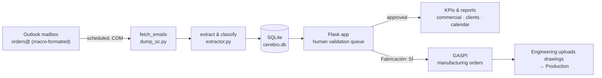

# ARIANA — Order intake & commercial intelligence for a technical office

**ARIANA** is an internal system I built for the technical office of an
industrial **filtration** company. It turns a noisy stream of purchase-order
emails into clean, validated, queryable data — and feeds the manufacturing
side of the business (a companion system, *GASPI*) with the jobs that need to
be produced.

> This is a **sanitized portfolio version** of a system running in internal
> production. All company names, client names, employee names, emails, prices
> and internal paths have been replaced with fictional data. The demo runs
> entirely on generated sample data — no mailbox and no real records required.

---

## The problem

Purchase orders arrived as free-form emails from a handful of salespeople.
Extracting them by hand was slow and error-prone, and the business had **no
reliable commercial data** on top of them — no clean client list, no
per-salesperson figures, no view of what was in the pipeline.

ARIANA solves three things at once:

1. **Structured capture** of every purchase order, on a schedule, with a
   human check before anything is trusted.
2. **A single source of truth** (one SQLite database) the whole office reads.
3. **Commercial intelligence** on top of it — KPIs, per-salesperson and
   per-client reports, a delivery calendar — plus a hand-off to production.

## How it works



1. **Capture** — A small Outlook VBA macro (`outlook/NuevaOC.bas`) lets each
   salesperson generate a purchase-order email in a **standard format** with
   one click. `dump_oc.py` reads the mailbox over COM on a schedule (4×/day)
   and snapshots each message to JSON, keeping the Outlook `EntryID` for
   idempotency.
2. **Extract & classify** — `extractor.py` parses the standard format
   deterministically (subject `OC-<CLIENT>-dd/mm/yyyy`, labelled body fields:
   client PO number, net amount, delivery date, supplier, *make-to-order?*).
   Anything that doesn't match the format is flagged for manual review instead
   of being silently dropped. Every insert is **idempotent** by `EntryID`.
3. **Human-in-the-loop validation** — The Flask app (`app.py`) shows a
   validation queue. A reviewer confirms or corrects each order; only then does
   it get a number (`OC-1000`, `OC-1001`, …) and flow downstream. Original
   sender is never overwritten — corrections live in a separate column for
   traceability.
4. **Commercial intelligence** — Validated orders feed a delivery **calendar**,
   a **commercial** view (revenue, average ticket, salesperson ranking) and a
   **client** view. Client names are **canonicalized** (an entity-resolution
   step that strips legal suffixes, folds accents and applies an alias map) so
   that `ACME CORP`, `ACME CORP S.A.` and `ACME-SP1234` all resolve to one
   client. Per-salesperson HTML reports are generated and emailed monthly.
5. **Hand-off to production** — Orders marked *make-to-order* are pushed to
   **GASPI**, where Engineering assigns a lot number, uploads the technical
   drawings (repeat products auto-fill their spec sheet, measurements and
   comments from just the part code), and the job moves on to Production.

## Tech stack

- **Python** — Flask (web app + REST), standard-library `sqlite3`, `pywin32`
  (Outlook COM automation).
- **SQLite** — single-file database, schema migrated in-app on startup.
- **Outlook VBA** — the client-side macro that standardizes the emails.
- **Vanilla HTML/CSS/JS** — no front-end framework; the UI is server-rendered
  templates plus a single-page dashboard.
- Runs on **Microsoft 365 / Windows** in production (COM needs a live Outlook
  session); the demo below runs anywhere Python does.

## Run the demo (no Outlook, no real data)

```bash
pip install -r requirements.txt
python seed_demo.py      # builds cerebro.db from the fictional sample inbox
python app.py            # http://127.0.0.1:5000   — login: admin / changeme
```

`seed_demo.py` runs the **real** extraction pipeline over 10 fictional
purchase-order emails (`sample_data/oc_emails.json`), then validates a subset
so the commercial views have data while a few stay in the validation queue.

## Repository layout

```
app.py                     Flask app: validation queue, calendar, commercial & client views, REST API
seed_demo.py               One-command demo: builds the DB from sample data
scripts/
  dump_oc.py               Snapshot the orders mailbox to JSON (Outlook COM)
  extractor.py             Parse & classify emails → SQLite (idempotent, human-review fallback)
  comercial_util.py        Salesperson resolution + client name canonicalization (entity resolution)
  informe_comercial.py     Per-salesperson commercial HTML reports
  crear_vault.py           Export the client/product graph as a linked Markdown knowledge base
  vault_merge_clientes.py  Reconcile that graph across data sources, preserving manual notes
  parse_ingenieria.py      Parse the engineering log (historical jobs) into structured data
  ...
outlook/NuevaOC.bas        Outlook VBA macro that standardizes the purchase-order email
templates/                 Server-rendered login + single-page dashboard
sample_data/               Fictional emails for the demo
```

## Notes

- **Configuration** — the mailbox address, the salesperson roster and a few
  paths are set near the top of `app.py` / `scripts/comercial_util.py`; they
  ship with placeholder values (`orders@example.com`, generic names).
- Some scripts (commercial reports, the client "vault", the engineering-log
  parser) read from external sources that are not part of this repo; the core
  intake pipeline above is fully runnable from the sample data.
- Built and maintained solo, in production use by Commercial, Engineering and
  Production teams.
